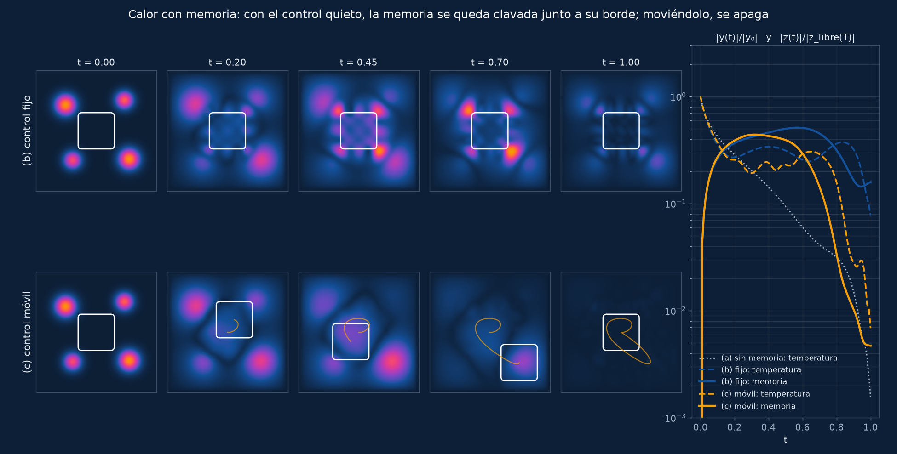

# Calor con memoria: por qué el control tiene que moverse

La ecuación del calor se puede llevar a cero actuando solo en un trozo ω del
dominio, por pequeño que sea. Al añadirle un **término de memoria** eso deja de
ser cierto si ω está quieto. Si ω se mueve, vuelve a serlo. Aquí se reproduce
ese resultado con control óptimo (CasADi + IPOPT) en un cuadrado 2D: la región
de control es un cuadrado suavizado que arrastra una partícula, y la fuerza
sobre la partícula es parte del control.



## De dónde viene

Es una versión rehecha del tutorial que Jesús Oroya y Umberto Biccari
publicaron en 2020 en el blog del proyecto ERC **DyCon** (DeustoTech):
[*Moving control strategy for memory-type equations*](https://deustotech.github.io/DyCon-Blog/tutorial/wp05/P0011).
El código de entonces ([MovilControlBlog.zip](https://deustotech.github.io/DyCon-Blog/assets/imgs/WP05/P0011/MovilControlBlog.zip),
MATLAB + DyCon Toolbox) era un borrador: malla de 8×8, 5 pasos de Euler
explícito, coste solo en el estado final y, de hecho, **sin el término de
memoria**. Solo se ha usado para orientarse: la ventana de Heaviside suavizada
y la partícula `d'' = g` vienen de ahí. Todo lo demás está hecho de nuevo.

Referencias teóricas:

- F. W. Chaves-Silva, L. Rosier, E. Zuazua, *Null controllability of a system
  of viscoelasticity with a moving control*, J. Math. Pures Appl. 101 (2014)
  198–222. Introduce el control móvil para este tipo de sistemas.
- F. W. Chaves-Silva, X. Zhang, E. Zuazua, *Controllability of evolution
  equations with memory*, SIAM J. Control Optim. 55(4) (2017) 2437–2459.
  Definen el control a cero «tipo memoria», que exige anular también la memoria
  en T, y lo prueban con soporte móvil.
- Q. Lü, X. Zhang, E. Zuazua, *Null control of heat equations with analytic
  memory kernels*, [arXiv:2511.02170](https://arxiv.org/abs/2511.02170) (2025).
  El modelo de abajo es su ec. (1.1) con núcleo constante.
- Citadas en el post original: U. Biccari, S. Micu, *Null-controllability
  properties of the wave equation with a second order memory term*, J.
  Differential Equations 267(2) (2019) 1376–1422; U. Biccari, M. Warma,
  *Null-controllability properties of a fractional wave equation with a memory
  term*, Evol. Equ. Control Theory 9(2) (2020) 399–430; Q. Lü, X. Zhang, E.
  Zuazua, *Null controllability for wave equations with memory*, J. Math. Pures
  Appl. 108(4) (2017) 500–531.

## El modelo

En Ω = (0,1)², con Dirichlet homogéneo:

```
y_t − ν Δy − μ ∫₀ᵗ Δy(s) ds = χ_ω(t) f
```

Con la variable de memoria `z(t) = ∫₀ᵗ y` queda un sistema EDP–EDO:

```
y_t = ν Δy + μ Δz + χ_ω(t) f
z_t = y                          ← una EDO en cada punto: z no difunde
```

Llevar el sistema a cero quiere decir `y(T) = 0` **y** `z(T) = 0`. Con ω fijo
no se puede: las altas frecuencias de z se comportan como una EDO
(`z_t ≈ −(μ/ν) z`) en cada punto. Fuera de ω nada las alcanza, y en el borde
de ω tampoco, porque desde dentro solo llegan componentes suaves. Si ω(t) se
mueve, el borde barre el dominio y nada se queda «clavado».

| parámetro | valor | |
|---|---|---|
| ν | 0,05 | difusión |
| μ | 0,03 | peso de la memoria (`μ/ν = 0,6`: la memoria se apaga sola en un tiempo ~1,7) |
| T | 1 | horizonte |
| ω | cuadrado de lado 0,3 | `χ = W(x)·W(y)`, `W` = diferencia de dos `½(1+tanh(κs))`, κ = 30 |
| y₀ | cuatro focos gaussianos | en (0,24, 0,72), (0,74, 0,76), (0,78, 0,26), (0,30, 0,25) |
| z₀ | 0 | |

**Control.** Dentro del cuadrado, `f` es un polinomio de grado ≤ 5 en cada
dirección, escrito en la base de Legendre normalizada **en el marco del
cuadrado**: 36 coeficientes por paso que viajan con él. En el caso móvil, el
centro del cuadrado es una partícula, `d'' = g`, con `|gₓ|, |g_y| ≤ 60`.

La primera versión usaba un `f` libre en cada nodo de la malla (1600 valores
por paso). IPOPT necesitaba ~1,4 s por iteración y en 1500 iteraciones no
cerraba el caso móvil. Con la base, el control no depende de la malla y una
iteración cuesta ~0,2 s. En (a) y (b) la restricción solo puede jugar en
contra de controlar, así que no hace trampa a favor del caso móvil.

## Discretización

- **Espacio:** diferencias finitas de 5 puntos, 40×40 nodos interiores
  (h = 1/41). El laplaciano discreto con Dirichlet se diagonaliza **exactamente**
  con la transformada de senos (DST-I, dos productos de matrices n×n), así que
  el paso implícito es una división elemento a elemento. No es un método
  espectral: da lo mismo que montar la matriz de 5 puntos y resolverla
  (peldaño 0, diferencia de 3·10⁻¹⁶).
- **Tiempo:** Euler implícito en el par (y, z), 100 pasos. Sustituyendo
  `z⁺ = z + dt·y⁺` queda `(1 + dt(ν + μ dt)Λ) ŷ⁺ = ŷ − dt μ Λ ẑ + dt b̂`.
  Es incondicionalmente estable. La partícula va con Euler simpléctico y la
  ventana se evalúa en la posición del final del paso.

## El problema de control óptimo

**Disparo simple**, como en [`pastoreo-optimo`](../pastoreo-optimo/): las
incógnitas son los controles y el estado sale de integrar (`mapaccum` de
CasADi, sin desplegar el grafo). Coste normalizado, cada término ~1 si «no
hago nada»:

```
J = |y(T)|²/|y₀|²                          temperatura final
  + |z(T)|²/|z_libre(T)|²                  memoria final   (no en (a))
  + β ∫∫_ω f² / (|y₀|²/T)                  esfuerzo        β = 1e-4
  + γ Σ|g|² dt / (T g_max²)                fuerza          γ = 1e-3 (solo (c))
  + ρ · (salirse de [0,12, 0,88]²)²        paredes         ρ = 1e3  (solo (c))
  + 10 · (|d(T)−d(0)|² + T²|v(T)|²)/lado²  volver al centro, parado (solo (c))
```

El último término no hace falta para controlar. Está para que el vídeo encadene
en bucle (véase más abajo). IPOPT trabaja con hessiano L-BFGS, incógnitas
escaladas (coeficientes/20 y fuerza/60, que quedan en [−1, 1]) y el objetivo
multiplicado por un factor que deja el gradiente inicial en ~1. La salida por
«acceptable level» está desactivada (`acceptable_iter = 0`): en (b) cortaba
antes de tiempo, y (b) y (c) tienen que estar igual de convergidos para
compararlos.

## Resultados (40×40, 100 pasos)

| caso | `|y(T)|/|y₀|` | sin control | `|z(T)|/|z_libre(T)|` | esfuerzo `∫∫(χf)²` | J |
|---|---:|---:|---:|---:|---:|
| (a) sin memoria, control fijo | **0,16 %** | 12,1 % | — | 0,007 | 2,0·10⁻⁵ |
| (b) con memoria, control fijo | **7,8 %** | 8,3 % | **15,8 %** | 1,41 | 3,3·10⁻² |
| (c) con memoria, control móvil | **0,69 %** | 8,3 % | **0,47 %** | 0,35 | 6,3·10⁻⁴ |
| (c) arrancando desde el reposo | 0,94 % | 8,3 % | 0,48 % | 0,41 | 6,7·10⁻⁴ |

- **(a)** El calor sin memoria se apaga desde el cuadrado fijo del centro, con
  muy poco esfuerzo.
- **(b)** Con memoria y el mismo cuadrado, el óptimo gasta **cuatro veces más**
  que (c) y aun así deja el 16 % de la memoria y casi toda la temperatura
  final (7,8 % frente a 8,3 % sin control). La figura enseña dónde: en
  estructuras finas pegadas al borde del cuadrado, sobre todo en sus esquinas.
  Son justo las altas frecuencias de z que no difunden.
- **(c)** Moviendo el cuadrado, temperatura y memoria bajan del 1 %, con un J
  53 veces menor que en (b).

**Qué hace el cuadrado.** Da un lazo de radio ~0,1 alrededor del centro, baja
hacia el foco inferior derecho (el más intenso) y vuelve. **No visita los
cuatro focos.** Lo que le hace falta no es pasar por encima de cada foco: la
memoria lejana es suave y la difusión se la lleva. Le hace falta que su borde
no se quede quieto en ningún sitio. El teorema exacto (control a cero
estricto) pide que ω(t) barra todo el dominio; aquí se minimiza un coste con
esfuerzo penalizado y el residuo es del 0,5 %, no cero.

**Arranque.** Por defecto (c) arranca de una trayectoria guía (un lazo
alrededor del centro); desde el reposo en el centro sale un J un 6 % mayor y la
misma memoria final (0,48 % frente a 0,47 %). El problema no es convexo y
estos dos óptimos locales difieren en detalles, no en el resultado. En los dos
casos, IPOPT agota las 3000 iteraciones con J todavía bajando despacio. No hay
certificado de óptimo para (c) (en (a) y (b) sí, véase el peldaño 3). Lo que
se afirma es la cota: con soporte móvil se llega **al menos** a esto.

## Validación

Tablas completas en [`salida/escalera.md`](salida/escalera.md), generadas a
partir de los JSON de `salida/`.

| peldaño | contra qué | resultado |
|---|---|---|
| 0. consistencia | matriz de 5 puntos montada a mano + `splu`; CasADi frente a numpy | 3·10⁻¹⁶ y 3·10⁻¹³ (precisión de máquina) |
| 1. integrador | solución exacta de modos de Fourier (sistema 2×2 por modo), con y sin memoria | orden **2,00** en h y **1,00** en dt; error relativo en producción 1,0 % (y) y 0,46 % (z), dominado por dt |
| 2. gradiente | diferencias finitas centradas | (b) 8·10⁻¹⁰; (c) 7·10⁻⁷, con el error bajando como ε² (truncamiento de la diferencia finita) |
| 3. optimalidad | (a) y (b) son cuadráticos: mínimo exacto por gradiente conjugado | J igual a 2·10⁻¹⁵ y f igual a 2·10⁻⁸ en (a) y en (b) |
| 4. arranque | (c) desde la guía y desde el reposo | memoria final 0,47 % y 0,48 % |
| 5. refinamiento | (b) frente a (c) con n = 20…60, 50/200 pasos, β = 10⁻³…10⁻⁵ | véase la tabla de abajo |

El peldaño 3 importa para el argumento: el residuo de (b) no es culpa del
optimizador, es el mínimo de verdad del problema discreto.

### (b) frente a (c) al refinar

Memoria final `|z(T)|/|z_libre(T)|` y esfuerzo `∫∫(χf)²`:

| malla | pasos | β | (b) memoria | (b) esfuerzo | (c) memoria | (c) esfuerzo | (b)/(c) |
|---:|---:|---:|---:|---:|---:|---:|---:|
| 20×20 | 100 | 10⁻⁴ | 16,7 % | 1,68 | 0,46 % | 0,35 | 36× |
| 30×30 | 100 | 10⁻⁴ | 16,1 % | 1,43 | 0,48 % | 0,36 | 33× |
| **40×40** | **100** | **10⁻⁴** | **15,8 %** | **1,41** | **0,47 %** | **0,35** | **34×** |
| 50×50 | 100 | 10⁻⁴ | 15,7 % | 1,40 | 0,46 % | 0,37 | 34× |
| 60×60 | 100 | 10⁻⁴ | 15,7 % | 1,39 | 0,47 % | 0,36 | 34× |
| 40×40 | 50 | 10⁻⁴ | 16,0 % | 1,46 | 0,47 % | 0,37 | 34× |
| 40×40 | 200 | 10⁻⁴ | 15,8 % | 1,38 | 0,47 % | 0,36 | 33× |
| 40×40 | 100 | 10⁻³ | 17,9 % | 0,49 | 1,53 % | 0,29 | 12× |
| 40×40 | 100 | 10⁻⁵ | 14,9 % | 12,9 | 0,23 % | 0,61 | 64× |

- **Malla y paso:** de 20×20 a 60×60 y de 50 a 200 pasos, las dos columnas
  se mueven menos de un punto. El resultado es del modelo, no de la
  discretización.
- **β, el dato que separa los dos casos:** al bajar β de 10⁻⁴ a 10⁻⁵, (b)
  gasta **nueve veces más** (1,4 → 12,9) para bajar la memoria del 15,8 % al
  14,9 %: está en una meseta. (c), con menos del doble de esfuerzo, baja del
  0,47 % al 0,23 %. Esa es la firma de «no controlable» frente a
  «controlable».

## El vídeo

Un bucle de 5 s a 30 fps, 3:1, con el dominio a la derecha (centro al 76 % del
ancho) y la mitad izquierda vacía para el texto. Se pinta la «huella»
`√((y/Y)² + (z/Z)²)` en un mapa de color fondo #0d1f36 → #14519b → #f59e0b,
interpolado en OKLCh pasando por el violeta (en RGB, el punto medio entre azul
y ámbar es un gris barroso). Así se ve primero el calor y luego la memoria que
deja.

**Por qué un ciclo con reinicio y no ida y vuelta.** Al reproducir hacia atrás,
el calor se «des-difundiría» y el cuadrado retrocedería: se nota que es falso.
Aquí el coste pide que el cuadrado termine en el centro y parado, que es donde
empieza, y el estado final es ~0. El bucle es: 0,5 s en los que aparecen los
focos con el cuadrado esperando en el centro, 4,5 s de la solución óptima y
0,25 s finales en los que el residuo (<1 %) se funde a cero. El último
fotograma es el primero.

| archivo | peso |
|---|---:|
| `salida/calor-memoria-2400x800.webm` (VP9, CRF 30) | 151 KB |
| `salida/calor-memoria-2400x800.mp4` (H.264, CRF 21) | 186 KB |
| `salida/calor-memoria-1200x400.webm` | 82 KB |
| `salida/calor-memoria-1200x400.mp4` | 89 KB |
| `salida/calor-memoria-poster-2400x800.webp` / `.png` | 15 / 233 KB |
| `salida/calor-memoria-poster-1200x400.webp` / `.png` | 6 / 82 KB |
| `salida/comparacion-b-c.png` / `.webp` (figura para el tutorial) | 535 / 64 KB |

## Cómo se reproduce

```bash
./run.sh              # todo
./run.sh escalera     # peldaños 0-3 (~5 min)
./run.sh casos        # (a), (b), (c) y (c) desde el reposo (~10 min en paralelo)
./run.sh refina       # peldaño 5
./run.sh salidas      # vídeos, póster, figura e informe
```

Python del entorno del repo (`../../.venv`: casadi 3.8, numpy, scipy,
matplotlib) y `ffmpeg` con libvpx-vp9 y libx264. Cada proceso usa un hilo
(`OMP_NUM_THREADS=1`) y `run.sh` reparte los casos en `NUCLEOS` procesos
(4 por defecto).

## Tiempos

Un hilo por proceso, con `nice` y la máquina cargada con otros trabajos:

| | |
|---|---:|
| construir el grafo de CasADi | 0,3 s |
| (a) 236 iteraciones | 37 s |
| (b) 715 iteraciones | 117 s |
| (c) 3000 iteraciones | 570 s |
| peldaños 0–3 | ~5 min |
| vídeos (2 tamaños × 2 códecs) | ~1 min |

## Lo que queda abierto

- (c) no cumple la tolerancia de IPOPT en 3000 iteraciones: J sigue bajando
  despacio. El residuo de la tabla es una cota superior de lo que da el
  control móvil, no el óptimo certificado.
- El sistema discreto es de dimensión finita y, en principio, (b) llegaría a
  cero con β → 0 a un coste enorme. Lo que se ve es la meseta (9× más
  esfuerzo por un punto menos de memoria), no un imposible. El teorema es del
  problema continuo, y la indicación numérica es que la meseta no se mueve al
  refinar la malla.
- La base de Legendre (grado 5) limita el control. Con un `f` libre por nodo,
  el resultado cualitativo era el mismo (primer prototipo, 24×24 y 40×40: (b)
  dejaba el 30 % de la memoria y (c) el 2,7 %, con β = 10⁻³).

## Archivos

| | |
|---|---|
| `python/modelo.py` | parámetros, base de senos, ventana, base de Legendre, paso implícito (CasADi y numpy), solución exacta por modos |
| `python/ocp.py` | coste, disparo simple, IPOPT |
| `python/experimento.py` | resuelve (a), (b), (c) y guarda trayectorias (`tmp/`) y métricas (`salida/casos-*.json`) |
| `python/escalera.py` | peldaños de validación (`salida/escalera-*.json`) |
| `python/render.py` | vídeos, póster y figura |
| `python/informe.py` | `salida/escalera.md` |
