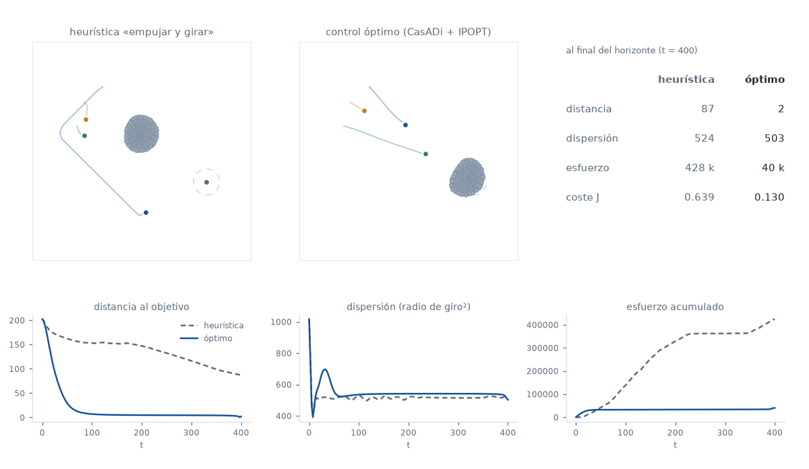

# Pastoreo con control óptimo: de la heurística a CasADi

Tres perros conducen 200 ovejas hasta un objetivo. En
[`particulas/pastoreo/`](../../particulas/pastoreo/) el perro seguía una
**heurística** —colocarse detrás y empujar— que funciona y se entiende de un
vistazo. Aquí se plantea la misma tarea como un **problema de control óptimo**:
en vez de decidir qué hace el perro en cada instante, se escribe lo que se
quiere conseguir y se deja que el optimizador encuentre la trayectoria.

El modelo, los parámetros y la heurística son los del TFM de Jesús Oroya,
*Aprendizaje por refuerzo aplicado al problema del pastoreo* (UPV/EHU, 2020), y
el planteamiento con CasADi es el de su código original en MATLAB,
[DeustoTech/GuidanceByRepulsion](https://github.com/DeustoTech/GuidanceByRepulsion).



## El modelo

Idéntico al del tutorial anterior (TFM, ec. 5.4–5.10), con masa unidad, de modo
que fuerza = aceleración:

```
ẋ_i = v_i    v̇_i = −ν_o v_i + Σ_k g_oo(r_ik) ê_ik + Σ_j g_op(r_ij) ê_ij
ẏ_j = w_j    ẇ_j = −ν_p w_j + Σ_k g_pp(r_jk) ê_jk + a_j     ← a_j es el control
```

| | |
|---|---|
| `g_oo(r) = −(1/r − 1/r_oo)` | oveja–oveja: atrae de lejos, repele de cerca |
| `g_op(r) = −F_m e^(−r²/σ²)` | perro → oveja: siempre repulsiva, alcance `σ` |
| `g_pp(r) = −(1/r − 1/r_pp)` | perro–perro: no se pisan |

Las ovejas sienten al perro; el perro no siente la reacción de las ovejas
(ec. 5.10). Es la misma asimetría «anti-newtoniana» que en LAMMPS obligaba a
usar `fix addforce` en vez de un `pair_style`.

Parámetros: `r_oo = 30`, `r_pp = 10`, `σ = 50`, `F_m = 5`, `ν_o = 0,45`,
`ν_p = 5`. Vienen calibrados del tutorial anterior y no se han tocado.

### Regularización (y por qué importa aquí)

Un optimizador basado en gradiente necesita que todo sea derivable, y en el
modelo tal cual hay dos sitios donde no lo es: `1/r` revienta en `r = 0` y la
norma `|d|` no es derivable en `d = 0`. Las dos se arreglan de una vez
evaluando las fuerzas en

```
r_ε = √(|d|² + ε²)        con ε = 1
```

tanto en el `1/r` como en el vector unitario `d/r_ε`. La fuerza resultante es
analítica en todas partes y tiende a cero linealmente cuando dos individuos se
superponen, en vez de diverger. El precio es un error relativo de `ε²/(2|d|²)`:
con la distancia típica entre ovejas (unas 10 unidades), un 0,5 %. El
[contraste con LAMMPS](salida/escalera.md) mide lo que supone en una
trayectoria completa: 0,05 % del recorrido.

## El problema de control

**Estado** (812 números con 200 ovejas y 3 perros): posiciones y velocidades de
todos. **Control**: las aceleraciones `a_j(t)` de los tres perros, acotadas por
componente, `|a_j^x|, |a_j^y| ≤ a_max = 25`.

**Coste**, con todos los términos normalizados para que los pesos signifiquen
algo:

```
J = |x̄(T) − x_T|² / L²                      llegar
  + λ · tr Cov(x(T)) / tr Cov(x(0))          no dispersar
  + β · Σ_k |a_k|² / (N n_p a_max²)          esfuerzo
  + γ · (1/N) Σ_k |x̄_k − x_T|² / L²          seguimiento
```

`L` es la distancia inicial del rebaño al objetivo. Cada término vale ~1 para
«no he hecho nada» y ~0 para «perfecto», así que `λ = 0,2` quiere decir
literalmente que agrupar pesa una quinta parte de llegar. Los dos primeros
términos son los del TFM (ec. 6.3); el tercero también. Pesos usados:
`λ = 0,2`, `β = 0,2`, `γ = 0,5`.

**El término de seguimiento no estaba en el enunciado** y conviene justificarlo:
sin él, el coste solo mira el instante final y su gradiente respecto a los
primeros controles atraviesa 160 intervalos de dinámica disipativa, de modo que
llega aplastado; el optimizador se dedica a afinar el final de la trayectoria y
deja el principio como estaba. Con `γ = 0,5` el problema sigue siendo el mismo
—llevar el rebaño al objetivo— pero el gradiente reparte información por todo
el horizonte. Se puede apagar con `--gam 0`.

## Discretización y resolución

**Disparo simple.** Las incógnitas son solo los controles; el estado sale de
integrar. No hay restricciones de dinámica —se cumplen por construcción— y el
problema queda como una minimización con cotas de caja, que es lo que mejor le
sienta a IPOPT con hessiano L-BFGS.

| | |
|---|---|
| horizonte | `T = 400` |
| intervalos de control | `N = 160` (`Δt = 2,5`), control constante a trozos |
| integración | RK4, `m = 10` subpasos por intervalo (`h = 0,25`) |
| incógnitas | `2 · n_p · N = 960` |
| gradiente | adjunto (AD inversa) de CasADi |
| optimizador | IPOPT, `hessian_approximation = limited-memory` |

La dinámica está vectorizada con `MX`: las `200 × 200` distancias entre ovejas
son dos `repmat` y un `mtimes`, no un bucle. El bucle temporal se cierra con
`mapaccum`, que repite el cuerpo sin desplegar el grafo: construirlo entero
cuesta 0,7 s y toda la sesión —coste, gradiente e IPOPT— cabe en 200 MB.

### Decisiones que no son obvias

**El paso de RK4 no se elige a ojo.** Con `h = 2,5` y `h = 1,25` la integración
**diverge**: el perro tiene una escala de tiempo de `1/ν_p = 0,2` y RK4 no la
aguanta. Con `h = 0,5` ya está cerca del límite (error 0,46 en el estado final)
y con `h = 0,25` el error cae a 6·10⁻⁵. Tabla completa en
[`salida/escalera.md`](salida/escalera.md).

**La heurística se simula en lazo cerrado, no congelada.** Es una ley de
realimentación en tiempo continuo: congelarla durante un intervalo entero
(2,5 unidades, doce veces su escala de tiempo) la vuelve inestable y la haría
quedar peor de lo que es. Se evalúa en cada subpaso, y lo que se compara con el
óptimo es la acción media por intervalo. El esfuerzo, en cambio, se acumula
subpaso a subpaso: promediar antes de elevar al cuadrado le rebajaría la
factura.

**El escalado del problema no es cosmético.** Tal cual, `|∂J/∂a| ~ 10⁻³` con
controles de orden 25, y IPOPT agota las iteraciones sin moverse del sitio. Hay
dos arreglos y los dos hacen falta: las incógnitas son `u = a/a_max ∈ [−1, 1]`,
y el objetivo se multiplica por un factor que deja el gradiente inicial en
~0,2. Ese factor **es** la longitud del primer paso de L-BFGS, que arranca con
el hessiano identidad: con un factor 50 veces mayor el primer paso saca los
controles del rango útil y la solución cae en la cuenca equivocada —el perro se
aleja hasta que su repulsión es despreciable, lo que es un punto estacionario
impecable y un resultado inútil. Está medido en el peldaño 2 de la escalera.

**`a_max = 25`.** La heurística sin cota llega a pedir aceleraciones de 430
—su término de giro crece con la distancia al rebaño—, pero en una corrida de
30 ovejas y un perro su mediana es 5,5 y su percentil 90, 52. Con `a_max = 25`
la heurística hace prácticamente lo mismo que sin cota (llega al objetivo en
t = 495 en vez de t = 435) y el óptimo no gana por tener más autoridad: las dos
políticas juegan con las mismas cartas.

**Tres perros con una heurística de uno.** La política del TFM es para un solo
perro: los tres tendrían la misma consigna y se amontonarían detrás del rebaño.
Se reparte el arco dando a cada perro un desfase `ψ_j` respecto a la línea
rebaño→objetivo (`ψ = −0,7, 0, +0,7` rad). El resto es la fórmula del TFM,
incluido el apagado continuo del giro cerca del objetivo (`d/(d + 8)`) que ya
hacía falta en LAMMPS.

**`r_pos` crece con el rebaño.** La heurística coloca al perro a una distancia
fija del centro del rebaño. Con 30 ovejas eran 45; con 200 el rebaño es más
ancho y esa distancia dejaría a los perros *dentro*, reventándolo desde el
medio. Se toma el radio del rebaño inicial más 25.

**Sin compilación JIT.** CasADi puede generar C y compilarlo, y para grafos
pequeños vuela. Aquí el grafo tiene 160 intervalos × 10 subpasos × 4
evaluaciones de una dinámica con matrices de 40 000 elementos: la compilación
no terminó en diez minutos. Se usa la máquina virtual de `MX`, que evalúa el
coste del problema grande en 2,5 s y su gradiente en 23 s.

## La escalera de pruebas

Nada de lo de abajo se mira hasta que lo de arriba funciona. Los números, en
[`salida/escalera.md`](salida/escalera.md); se regeneran con `./run.sh escalera`.

| | qué comprueba | resultado |
|---|---|---|
| 0 | el paso de RK4 no decide el resultado | con `h ≥ 1,25` diverge; con `h = 0,25`, error 6·10⁻⁵ |
| 0b | la dinámica es la ya validada en LAMMPS | el centro del rebaño coincide con error del 0,05 % del recorrido |
| 1 | el gradiente por AD es correcto | 4,5·10⁻¹⁰ frente a diferencias finitas, y 18 veces más rápido |
| 2 | 1 perro + 1 oveja, como en Escobedo et al. | el perro se coloca detrás (cos = 0,999) a 42 unidades (σ = 50) y empuja |
| 3 | 20 ovejas + 1 perro | J de 0,374 a 0,161; la dispersión final cae a la cuarta parte |
| 4 | 200 ovejas + 3 perros | ver abajo |

El peldaño 2 da el resultado más instructivo de todos. Si el perro empieza del
**lado equivocado** (entre la oveja y el objetivo) y se arranca el optimizador
de control nulo, IPOPT converge —`Solve_Succeeded`, sin quejarse— a la solución
de abandonar: el perro se va lejos, su repulsión se anula, el gradiente también,
y la oveja se queda donde está. Arrancando de la heurística, que sabe rodear, el
mismo optimizador con el mismo coste encuentra la solución buena y lleva la
oveja al objetivo. El arranque en caliente no es una optimización de velocidad:
decide qué solución se encuentra.

## Resultados

200 ovejas, 3 perros, horizonte 400, las dos políticas con la misma dinámica y
la misma cota `a_max = 25`:

| al final del horizonte | heurística | óptimo |
|---|---:|---:|
| coste `J` | 0,639 | **0,130** |
| distancia al objetivo | 86,9 | **2,0** |
| cuándo llega a menos de 20 | nunca | **t = 60** |
| dispersión (radio de giro²) | 524 | 503 |
| esfuerzo `∫Σ|a|² dt` | 428 300 | **39 982** |

El óptimo no gana por poco: **llega** —la heurística, con 200 ovejas, ya no— y
lo hace gastando **diez veces menos**. La diferencia se ve en la animación: los
perros de la heurística pasan la mitad del tiempo orbitando alrededor del
rebaño, porque su término de giro los hace rodear hasta colocarse en la línea
exacta rebaño→objetivo y lo vuelve a hacer cada vez que el rebaño se desvía.
Los perros del óptimo empujan en diagonal, aceptan que el rebaño no vaya recto
y corrigen al final.

Que la heurística falle aquí y funcionara en
[`particulas/pastoreo/`](../../particulas/pastoreo/) con 30 ovejas no es un
defecto de la implementación: es la limitación que el propio TFM le atribuye
—«tiene limitaciones cuando la dispersión de las ovejas es grande con respecto
a la distancia entre la media de las posiciones de las ovejas y la posición del
perro»—. Un rebaño de 200 ocupa más sitio, los perros tienen que colocarse más
lejos y el giro les cuesta más vueltas.

### Lo que cuesta

| | |
|---|---:|
| construir el grafo (812 estados, 160 intervalos) | 0,5 s |
| una evaluación del coste | 2,5 s |
| un gradiente completo por AD inversa | 23 s |
| 200 iteraciones de IPOPT (1093 costes + 201 gradientes) | 105 min |
| memoria | 200 MB |
| infactibilidad dual al parar | 3,6·10⁻⁴ |

No converge: para en el máximo de iteraciones con la condición KKT en 3,6·10⁻⁴.
Las últimas decenas de iteraciones apenas mueven el coste —el grueso de la
mejora está en las primeras 40—, así que para el resultado da igual, pero no
hay que llamarlo óptimo global ni mínimo local certificado: es el mejor punto
que IPOPT alcanzó en 105 minutos partiendo de la heurística.

### El coste se cumple al pie de la letra

El funcional pide dispersión pequeña **al final**, y eso es exactamente lo que
el optimizador entrega: con 20 ovejas, la trayectoria óptima estira el rebaño
en un arco de dispersión 6 211 a mitad de camino —la heurística nunca pasa de
673— y lo recoge justo a tiempo para acabar en 198. Es correcto y es
desagradable de ver.

Con 200 ovejas no pasa, pero no porque el coste lo impida: la cohesión `g_oo`
suma sobre todo el rebaño, de modo que con 200 individuos es siete veces más
fuerte que con 30 y mantiene el grupo unido aunque el optimizador no lo pida
(la dispersión se queda en 503, prácticamente la misma que con la heurística).
Es suerte, no diseño.

Añadiendo un peso `λ_t` sobre la dispersión *a lo largo* del horizonte
(`--lam-t 0.3`) el rebaño se mantiene compacto (máximo 843) y además acaba más
cerca del objetivo (2,2 frente a 7,8), a cambio de un 80 % más de esfuerzo. Es
la lección más transferible del tutorial: el optimizador no hace lo que uno
quiere, hace lo que uno escribe.

## Lo que no está

- **Cerca o barreras.** El enunciado natural siguiente es añadir una penalización
  suave por salirse de una zona; aquí no hay ninguna restricción espacial.
- **Lazo cerrado.** Esto es control en lazo abierto: una trayectoria calculada
  de antemano para un estado inicial. Si una oveja se desvía, nadie corrige. La
  versión honesta sería MPC (reoptimizar cada pocos pasos), que es justo lo que
  hacen Ko y Zuazua con *random batch*.
- **El aprendizaje por refuerzo del TFM**, que resuelve precisamente el problema
  de que la solución óptima depende del estado inicial.

## Reproducir

```bash
./run.sh              # todo (el caso grande tarda ~1 h)
./run.sh escalera     # solo las comprobaciones (~5 min)
./run.sh grande       # solo el problema de 200 ovejas y 3 perros
./run.sh salidas      # binario del visor, póster e informe
```

Necesita Python 3 con `casadi`, `numpy` y `matplotlib` (el script crea el
entorno en `.venv/` del repo si no existe) y, opcionalmente, LAMMPS para el
contraste del peldaño 0b. La demo web se abre con cualquier servidor estático
sobre `web/`.

## Ficheros

| | |
|---|---|
| `python/modelo.py` | la dinámica, vectorizada en CasADi, y el escenario |
| `python/politica.py` | la heurística «empujar y girar» para `n_p` perros |
| `python/simula.py` | rollouts: con control dado o con política en lazo cerrado |
| `python/ocp.py` | el problema de disparo simple, el coste y la llamada a IPOPT |
| `python/escalera.py` | los peldaños de comprobación |
| `python/experimento.py` | el caso grande: heurística contra óptimo |
| `python/exporta.py` | el binario `.herd2` con las dos trayectorias |
| `python/poster.py` | la figura de respaldo |
| `python/informe.py` | `salida/escalera.md` a partir de los JSON |
| `lammps/in.contraste` | el mismo modelo en LAMMPS, para el peldaño 0b |
| `web/` | visor en canvas 2D, sin dependencias, con los dos paneles |

## Referencias

- J. Oroya, *Aprendizaje por refuerzo aplicado al problema del pastoreo*, TFM,
  UPV/EHU, 2020. Director: Roberto Santana. **Modelo, parámetros y heurística.**
- R. Escobedo, A. Ibáñez, E. Zuazua, *Optimal strategies for driving a mobile
  agent in a "guidance by repulsion" model*, Commun. Nonlinear Sci. Numer.
  Simul. **39** (2016) 58–72. [arXiv:1509.05008](https://arxiv.org/abs/1509.05008)
- D. Ko, E. Zuazua, *Model predictive control with random batch methods for a
  guiding problem*. [arXiv:2004.14834](https://arxiv.org/abs/2004.14834)
- Código original en MATLAB/CasADi:
  [DeustoTech/GuidanceByRepulsion](https://github.com/DeustoTech/GuidanceByRepulsion)
- J. Andersson et al., *CasADi: a software framework for nonlinear optimization
  and optimal control*, Math. Prog. Comp. **11** (2019) 1–36.
