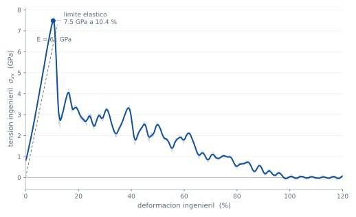

# Ensayo de tracción de un nanohilo de cobre

Dinámica molecular de un nanohilo de Cu orientado en [100] estirado a
velocidad de deformación constante hasta que rompe. Sale de aquí la animación
de la portada de djoroya.com, que el navegador dibuja en vivo a partir de un
binario de 1,8 MB (793 KiB comprimido) con 80 fotogramas.

Potencial **EAM de Mishin et al.**, Phys. Rev. B **63**, 224106 (2001)
(`Cu_mishin1.eam.alloy`, distribuido con LAMMPS). Todo se ejecuta con LAMMPS
7 Feb 2024.

## Primero, validar el potencial

Antes de mirar ningún resultado bonito: con el mismo potencial y la misma
instalación de LAMMPS, calcular magnitudes que tienen una referencia conocida
y comparar. La tabla completa, con las fuentes, está en
[`salida/validacion.md`](salida/validacion.md).

| Magnitud | Calculado | Referencia | Error |
|---|---:|---:|---:|
| Parámetro de red `a0` (Å) | 3,6149 | 3,615 | +0,00 % |
| Energía cohesiva (eV/átomo) | 3,5402 | 3,54 | +0,01 % |
| `C11` (GPa) | 169,9 | 168,4 | +0,90 % |
| `C12` (GPa) | 122,6 | 121,4 | +1,01 % |
| `C44` (GPa) | 76,2 | 75,4 | +1,07 % |
| Módulo de Young `E[100]` (GPa) | 67,12 | 66,7 | +0,62 % |
| Energía de falla de apilamiento (mJ/m²) | 44,38 | 45 | −1,38 % |

Dos matices que hacen honesta la tabla:

- Las cinco primeras magnitudes **formaban parte del conjunto al que se ajustó
  el potencial**. Que salgan bien no demuestra que el potencial prediga nada:
  demuestra que la cadena (potencial, celdas, deformaciones, unidades) está
  bien montada. Que es justo lo que se quiere comprobar antes de simular.
- `E[100]` se calcula por dos caminos independientes —de las constantes
  elásticas y estirando la celda mientras se deja relajar la sección a tensión
  transversal nula— y coinciden en cuatro cifras (67,1156 y 67,1147 GPa). Esa
  es la comprobación interna de que la deformación aplicada y la tensión
  medida son coherentes; es exactamente el mismo cálculo que luego se hace
  sobre el nanohilo.

La energía de falla de apilamiento es la más interesante de las siete: no es
una propiedad de volumen, sino la que gobierna que las dislocaciones se
disocien en parciales de Shockley, que es el mecanismo que se ve en la
animación.

## La simulación

| | |
|---|---|
| Geometría | sección cuadrada {100} de 8 × 8 celdas, 20 celdas de largo: 2,9 × 2,9 × 7,2 nm, **5780 átomos** |
| Contorno | periódico en el eje del hilo, superficies libres en las cuatro caras |
| Paso de tiempo | 2 fs |
| Equilibrado | minimización + NVT a 300 K durante 20 ps |
| Tracción | velocidad de deformación 5·10⁹ s⁻¹ hasta ε = 1,2, NVT a 300 K |
| Salidas | curva tensión-deformación cada 100 pasos; 193 volcados con CNA por átomo |

La tensión es la ingenieril, σ = F/A₀, con la fuerza sacada del virial
(`compute stress/atom`, que devuelve −P·V) y A₀ **la sección efectiva**
N·Ω/L₀, con Ω = a₀³/4 el volumen por átomo. Se usa esa definición y no el
«8 a₀ × 8 a₀» nominal porque la sección de un nanohilo es ambigua en medio
plano atómico, y ese medio plano son aquí un 6 % de error.

### Resultados

| | |
|---|---|
| Módulo de Young del hilo a 300 K | **61,0 GPa** |
| Límite elástico | **7,48 GPa** a ε = 10,4 % |
| Rotura | ε ≈ **104 %** |



Tres cosas que merece la pena mirar:

- **61,0 GPa frente a los 67,1 GPa del cristal infinito a 0 K.** La diferencia
  es real y tiene dos causas que van en el mismo sentido: la temperatura
  ablanda el cristal, y en un hilo de 2,9 nm casi un tercio de los átomos está
  en la superficie, con menos vecinos.
- **Un límite elástico de 7,5 GPa, E/8.** Es el orden de la resistencia
  teórica del cristal, y es lo que se espera: el hilo se construye perfecto,
  sin ninguna dislocación, así que no puede deformarse plásticamente hasta
  que nuclea la primera, y eso ocurre en una arista de la superficie.
- **Después de ceder, la tensión cae en picado y el hilo fluye hasta duplicar
  su longitud.** En la animación se ve que la plasticidad va por maclado: las
  fallas de apilamiento (en azul) barren el hilo, la sección se va estrechando
  hasta formar un cuello y ahí rompe.

Un aviso para quien compare con un ensayo real: 5·10⁹ s⁻¹ son unos catorce
órdenes de magnitud más que un ensayo de laboratorio. Es lo que permite la
dinámica molecular, y hace que las tensiones salgan altas y la plasticidad
quede concentrada en pocos mecanismos. El objetivo aquí es la validación del
potencial y el mecanismo, no reproducir un ensayo normalizado.

## El binario para el visor

`python/exporta.py` recorta la trayectoria hasta poco después de la rotura,
toma 80 fotogramas y los escribe en un formato propio muy sencillo:

- el **primer fotograma**, con las posiciones cuantizadas a 16 bits;
- los **demás, como incrementos** de un byte con signo respecto al anterior,
  en unidades de 0,07 Å;
- el **tipo de estructura** (CNA) en un byte por átomo y fotograma.

La clave del tamaño está en los incrementos: entre dos fotogramas un átomo se
mueve décimas de angstrom, así que son números pequeños y muy repetidos, que
es lo que gzip aprovecha. Guardando las posiciones absolutas en 16 bits el
fichero comprimido ocupaba **2,3 MB**; con incrementos, **793 KiB**. El
incremento se calcula contra la posición que va a reconstruir el visor, no
contra la exacta, para que el error no se acumule: el error máximo de
reconstrucción es de 0,035 Å, una treintava parte del radio atómico.

Junto al binario, `salida/nanohilo-cu-meta.json` lleva lo que necesita la
interfaz del visor: tiempo simulado y deformación de cada fotograma, y la
curva tensión-deformación remuestreada a ~360 puntos para dibujarla al lado
de la animación. Va aparte del `.nw` porque son cuatro cifras por fotograma y
así el binario no cambia de versión cada vez que la interfaz necesita un dato
más.

| Fichero | Tamaño |
|---|---:|
| `salida/nanohilo-cu.nw` | 1,78 MiB (**797 KiB** servido con gzip) |
| `salida/nanohilo-cu-meta.json` | 5,7 KiB (2,2 KiB con gzip) |
| `salida/nanohilo-cu-poster.png` | 53 KiB |
| `salida/tension-deformacion.svg` | 74 KiB |

El visor está en [`../../visor`](../../visor), y
`visor/test/formato.mjs` comprueba sin navegador que su parser reconstruye
exactamente los mismos números que escribió Python.

## Reproducir

```bash
./run.sh              # validación + simulación + salidas (unos minutos)
./run.sh validacion   # solo la validación del potencial
./run.sh simulacion   # solo el ensayo de tracción
./run.sh salidas      # curva, binario y póster, reusando los volcados
```

Necesita LAMMPS con los paquetes MANYBODY y OPENMP, y Python 3 (el script crea
el entorno virtual con numpy y matplotlib la primera vez). Variables útiles:
`HILOS`, `NSEC`, `NLONG`, `EPSMAX`, `NFRAMES`.

Los ficheros pesados (volcados, logs) se quedan en `datos/`, fuera de git.

## Ficheros

| | |
|---|---|
| `lammps/in.validacion` | a₀, energía cohesiva, `C11`, `C12`, `C44`, `E[100]` |
| `lammps/in.falla` | energía de falla de apilamiento intrínseca |
| `lammps/in.nanohilo` | el ensayo de tracción |
| `python/tabla.py` | la tabla de validación |
| `python/curva.py` | la curva tensión-deformación en SVG |
| `python/exporta.py` | el binario `.nw` y el `meta.json` para el visor |
| `python/vista_previa.py` | hoja de contacto para revisar la animación sin navegador |
| `python/render.py` | el póster de respaldo |

## Referencia

Y. Mishin, M. J. Mehl, D. A. Papaconstantopoulos, A. F. Voter y J. D. Kress,
*Structural stability and lattice defects in copper: ab initio, tight-binding
and embedded-atom calculations*, Phys. Rev. B **63**, 224106 (2001).
