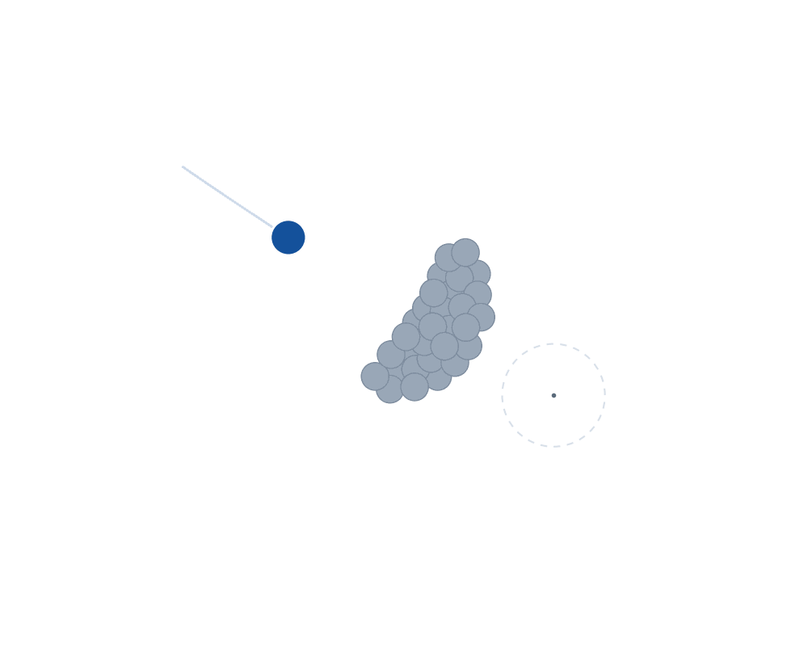

# Pastoreo: guiar un rebaño solo con repulsión

Un perro conduce 30 ovejas hasta un objetivo sin tirar de ellas: solo las
repele. Dinámica de partículas en 2D con LAMMPS, animación en el navegador
con un canvas de 9 KiB.

El modelo y la política son los del TFM de Jesús Oroya, **«Aprendizaje por
refuerzo aplicado al problema del pastoreo»** (Máster en Ingeniería
Computacional y Sistemas Inteligentes, UPV/EHU, 2020; director: Roberto
Santana), que a su vez parte del paradigma *guidance by repulsion* de
Escobedo, Ibáñez y Zuazua.

## El modelo

Cada individuo es un punto con masa unidad en el plano. Las interacciones son
radiales: dependen solo de la distancia y actúan en la línea que une a los dos
individuos. El TFM las define así (ec. 5.4–5.6):

| Interacción | Fuerza | Qué hace |
|---|---|---|
| oveja–oveja | `g_oo(r) = −(1/r − 1/r_min^o)` | atrae de lejos, repele de cerca: el rebaño se junta pero no se apelmaza |
| perro → oveja | `g_op(r) = −F_m · exp(−r²/σ²)` | siempre repulsiva, con alcance `σ` |
| perro–perro | `g_pp(r) = −(1/r − 1/r_min^p)` | evita que dos perros choquen (aquí solo hay uno) |

El signo sigue el convenio del TFM: la aceleración sobre el individuo `i` es
`g(r)·(u_k − u_i)/|u_k − u_i|`, de modo que `g > 0` atrae hacia `k` y `g < 0`
lo repele.

La dinámica es de segundo orden con rozamiento (ec. 5.9–5.10):

```
u̇_o = v_o     v̇_o = −ν_o v_o + G_oo + G_op
u̇_p = v_p     v̇_p = −ν_p v_p + G_pp + a      ← a es la acción del perro
```

Lo interesante del problema está en ese `a`: el perro es el único agente que
se controla, y solo puede influir en las ovejas repeliéndolas.

### La política «empujar y girar»

La heurística del TFM (ec. 7.1–7.3) no necesita saber dónde está cada oveja,
solo la posición media del rebaño `u_om`. Tiene dos términos:

```
a = h_r(r) (u_om − u_d) + h_p(φ) (u_d − u_om)^⊥
h_r(r) = −1/r + 1/r_pos          φ = ángulo entre (u_om − u_T) y (u_d − u_om)
h_p(φ) = 1 − cos φ
```

El primero coloca al perro a una distancia fija del rebaño; el segundo lo hace
girar alrededor de él hasta ponerse **detrás**, en la línea que une rebaño y
objetivo. Cuando ya está detrás, `φ = 0`, `h_p = 0` y deja de girar: solo
empuja.

## Lo que implementa LAMMPS, y en qué se diferencia

| Del TFM | En LAMMPS | Diferencia |
|---|---|---|
| `g_oo` entre ovejas | `pair_style table` con una tabla generada por `python/tabla.py` | interpolación: 0,18 % de error (ver [verificación](salida/verificacion.md)) |
| `g_op` del perro sobre las ovejas | `fix addforce` con variables que leen la posición del perro por su ID | ninguna: se evalúa la fórmula, error ~10⁻¹⁵ |
| rozamiento `−ν v` | `fix viscous` | ninguna |
| política del perro | `compute com` + variables + `fix addforce` | ninguna |
| integración RK4 | velocity-Verlet (`fix nve`) | ver abajo |

Dos decisiones que merecen explicación:

**La repulsión del perro no puede ser un `pair_style`.** En el modelo, el
perro repele a las ovejas pero no siente la reacción (ec. 5.10: sobre el perro
solo actúan `G_pp` y su propia acción). Eso viola la tercera ley de Newton, y
los `pair_style` de LAMMPS siempre aplican fuerzas iguales y opuestas. Por eso
va con `fix addforce` sobre el grupo de ovejas: así solo la reciben ellas. Es
la misma asimetría que los autores del modelo original llaman
«anti-newtoniana».

**RK4 frente a velocity-Verlet.** El TFM integra con Runge-Kutta de orden 4;
LAMMPS usa velocity-Verlet, que es de orden 2 pero simpléctico. Para este
problema, que es disipativo y no conservativo, la ventaja simpléctica no
aporta; lo que importa es que el paso sea bastante pequeño. Con `dt = 0,01` y
las escalas de aquí, el caso de validación de la sección siguiente reproduce
un valor analítico con 12 cifras, así que el integrador no es el límite.

## Parámetros

| Parámetro | Valor | De dónde sale |
|---|---:|---|
| `r_min^o` (oveja–oveja) | 30 | TFM, figura 5 |
| `r_min^p` (perro–perro) | 10 | TFM, figura 5 |
| `σ` (alcance de la repulsión) | 50 | TFM, figura 5 |
| `F_m` (intensidad de la repulsión) | 5 | calibrado aquí; la figura 5 del TFM sugiere ≈ 7 |
| `ν_o` (rozamiento de las ovejas) | 0,45 | código original `DeustoTech/GuidanceByRepulsion` |
| `ν_p` (rozamiento del perro) | 5 | ídem |
| `r_pos` (distancia perro–rebaño) | 45 | calibrado aquí, ver abajo |
| ganancia de la política | 2,5 | calibrado aquí |
| ovejas | 30 | |
| paso de tiempo | 0,01 | |

Tres cosas que tuve que ajustar y conviene no esconder:

1. **`r_pos` no puede ser `r_min^p`.** La política del TFM lleva al perro a
   `r_min^p = 10` del centro del rebaño, pero un rebaño de 30 ovejas tiene un
   radio de ~35: el perro acabaría *dentro* y lo reventaría desde el medio. Es
   un efecto que el propio TFM anticipa («es posible que esta acción disperse
   a las ovejas»). Se separa en un parámetro propio, `r_pos = 45`.
2. **La suma de `g_oo` no se normaliza.** El cuadro 2 del TFM suma sobre todas
   las ovejas sin dividir por `N`; el código posterior sí divide por `N−1`. Con
   la normalización, la cohesión queda 30 veces por debajo de la repulsión del
   perro y el rebaño se deshace en cuanto el perro se acerca. Se usa la versión
   del TFM, sin normalizar.
3. **La política es singular en el objetivo.** Cuando el rebaño se posa justo
   sobre `u_T`, el ángulo `φ` no está definido (`u_om − u_T = 0`). Se apaga el
   giro de forma continua con un factor `d/(d + 8)`. Sin eso, el perro entra en
   barrena y acaba saliéndose del dominio.

## Resultados



| | |
|---|---:|
| Distancia inicial del rebaño al objetivo | 202 |
| Tiempo en llegar (distancia < 20) | 400 |
| Distancia media después de llegar | 4,0 |
| Dispersión inicial (radio de giro²) | 1006 |
| Dispersión media después de llegar | 418 |

Dos lecturas. La **dispersión baja a la mitad**: el perro no solo conduce al
rebaño, lo agrupa por el camino, que es el comportamiento que se espera de la
repulsión con la cohesión `g_oo`. Y después de llegar la distancia al objetivo
**no se queda en cero, oscila** entre 0 y 19: la heurística lleva el rebaño
donde se quiere pero no lo sostiene sin seguir actuando. En la animación se ve
muy claro al final, cuando el perro se queda dando vueltas alrededor del
rebaño ya colocado.

Eso es exactamente lo que el TFM reporta (figura 9) y lo que motivaba allí
pasarse al aprendizaje por refuerzo: una política entrenada con DDPG resultaba
más lenta pero estable. Ese trabajo está en el TFM; aquí solo se reproduce la
heurística.

## Comprobaciones

Están en [`salida/verificacion.md`](salida/verificacion.md), en tres niveles:

1. **Las fuerzas son las del modelo**: se comparan con las fórmulas en 60
   distancias. `fix addforce` da error 5·10⁻¹⁵; la tabla, 1,8·10⁻³ relativo.
2. **Un caso con solución analítica**: el modelo de un perro y una oveja de
   Escobedo, Ibáñez y Zuazua (2016) acaba, en modo persecución, con ambos
   viajando en línea recta separados `√2` a velocidad `1/√2`. LAMMPS lo
   reproduce con **error de 3·10⁻¹²**. Es la comprobación que más vale: un
   número cerrado, sin ajustar nada.
3. **El ensayo completo**, que es cualitativo: llega al objetivo, agrupa el
   rebaño y oscila, como en el TFM.

## Reproducir

```bash
./run.sh              # todo: tablas, simulaciones, comprobaciones y web
./run.sh simulacion   # solo los ensayos de LAMMPS
./run.sh salidas      # comprobaciones, binario del visor y póster
```

Necesita LAMMPS (cualquier versión reciente; no hace falta ningún paquete
especial) y Python 3 con numpy y matplotlib. La demo web se abre con cualquier
servidor estático sobre `web/`.

## Ficheros

| | |
|---|---|
| `lammps/in.pastoreo` | el ensayo: un perro, 30 ovejas y la política |
| `lammps/in.pareja` | un perro y una oveja, modelo de Escobedo et al. (2016) |
| `lammps/in.fuerzas` | mide la fuerza entre dos individuos a varias distancias |
| `python/tabla.py` | genera la tabla de `g_oo` para `pair_style table` |
| `python/verifica.py` | las tres comprobaciones |
| `python/exporta.py` | el binario `.herd` para el visor |
| `python/poster.py` | la imagen de respaldo |
| `web/` | visor en canvas 2D, sin dependencias |

## Referencias

- J. Oroya, *Aprendizaje por refuerzo aplicado al problema del pastoreo*, TFM,
  Máster en Ingeniería Computacional y Sistemas Inteligentes, UPV/EHU, 2020.
  Director: Roberto Santana. **Modelo y política que se implementan aquí.**
- R. Escobedo, A. Ibáñez, E. Zuazua, *Optimal strategies for driving a mobile
  agent in a "guidance by repulsion" model*, Commun. Nonlinear Sci. Numer.
  Simul. **39** (2016) 58–72. [arXiv:1509.05008](https://arxiv.org/abs/1509.05008)
- D. Ko, E. Zuazua, *Asymptotic behavior and control of a "guidance by
  repulsion" model*. [arXiv:1911.01133](https://arxiv.org/abs/1911.01133)
- D. Ko, E. Zuazua, *Model predictive control with random batch methods for a
  guiding problem*. [arXiv:2004.14834](https://arxiv.org/abs/2004.14834)
- Código original (MATLAB/CasADi):
  [DeustoTech/GuidanceByRepulsion](https://github.com/DeustoTech/GuidanceByRepulsion)
