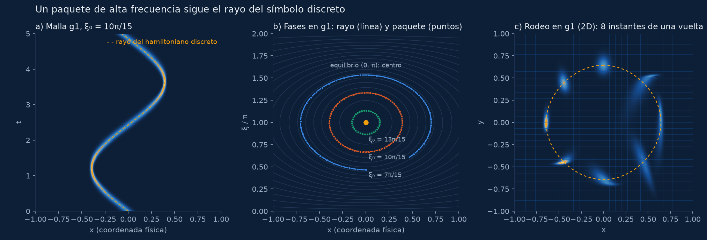
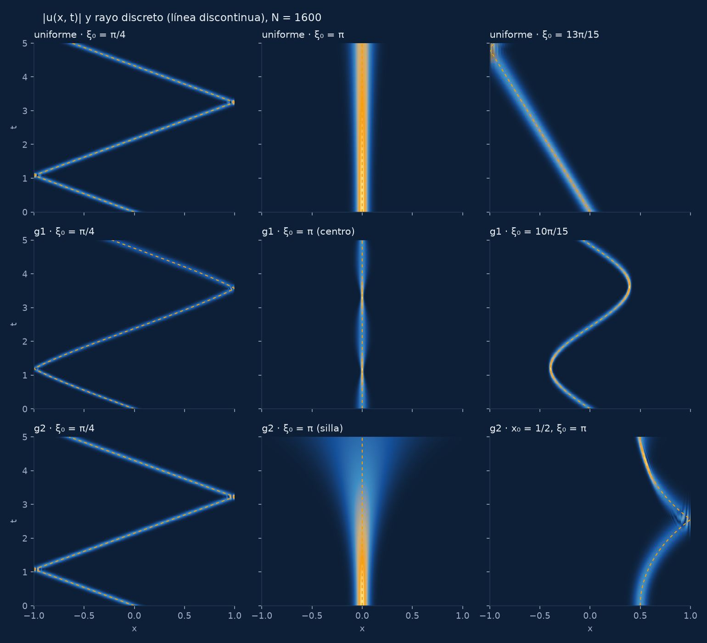
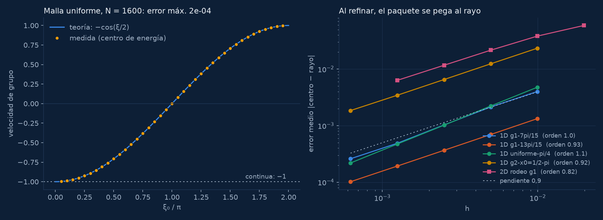

# Ondas discretas: cuando la malla dobla los rayos

Discretizada en espacio con diferencias finitas, la ecuación de ondas deja de
comportarse como la continua en alta frecuencia. Un paquete gaussiano muy
concentrado y oscilante (un *haz gaussiano*) no viaja a velocidad 1 en línea
recta: viaja a lo largo de los **rayos del hamiltoniano del símbolo discreto**,
y esos rayos pueden frenarse hasta pararse, darse la vuelta sin tocar el borde
o, en 2D, quedarse dando vueltas en círculo.



## De dónde viene

Es la versión rehecha en Python del tutorial que Jesús Oroya publicó con
Umberto Biccari en el blog del proyecto ERC DyCon (26 de junio de 2019):

- U. Biccari y J. Oroya, *Propagation of one and two-dimensional discrete waves
  under finite difference approximation*, DyCon Blog,
  <https://deustotech.github.io/DyCon-Blog/tutorial/wp99/P0008>.

que ilustra el artículo

- U. Biccari, A. Marica y E. Zuazua, *Propagation of one- and two-dimensional
  discrete waves under finite difference approximation*, Foundations of
  Computational Mathematics **20** (2020) 1401–1438,
  doi:[10.1007/s10208-020-09445-0](https://doi.org/10.1007/s10208-020-09445-0)
  (preprint: [arXiv:1806.09313](https://arxiv.org/abs/1806.09313)).

Las ecuaciones, las mallas y los datos iniciales son los del artículo y del
código MATLAB original del post; no se ha copiado ninguna imagen ni vídeo: todo
se recalcula aquí.

## El modelo

**Semidiscretización (art. §2.1).** Malla uniforme de cálculo
`x_j = −1 + j h`, `h = 2/(N+1)`, transformada por un difeomorfismo `g` en la
malla física `g_j = g(x_j)`. Con `h_{j+1/2} = g_{j+1} − g_j` y
`m_j = (h_{j+1/2} + h_{j−1/2})/2`:

```
m_j u_j'' = (u_{j+1} − u_j)/h_{j+1/2} − (u_j − u_{j−1})/h_{j−1/2},   u_0 = u_{N+1} = 0
```

En 2D, la malla producto y el operador suma de dos copias del 1D (§3.1).

**Mallas (2.9):** uniforme, `g1(x) = tan(πx/4)` (fina en el centro, gruesa en
los bordes) y `g2(x) = 2 sin(πx/6)` (gruesa en el centro, fina en los bordes).

**Dato inicial (2.10, 3.13):** `exp(−γ/2 (x − x0)²) · exp(i ξ0 x / h)` en la
coordenada de cálculo, con `γ = h^−0.9`, y `u_t(0) = i √A u0` (una sola rama,
`e^{+iωt}`, como en el código original: un solo paquete en vez de dos).

**Rayos (2.8, 3.9).** Con `c = 1/g'` y `λ(x, ξ) = 2 sin(ξ/2) c(x)`:

```
1D:  x' = −cos(ξ/2) c(x)              ξ' = 2 sin(ξ/2) c'(x)
2D:  x' = −(λ1/r0) cos(ξ/2) c(x)      ξ' = (λ1/r0) 2 sin(ξ/2) c'(x)    (y, η igual)
     r0 = √(λ1² + λ2²) se conserva
```

con `ξ ∈ [0, 2π]` y reflexión `ξ → 2π − ξ` en `x = ±1`. La velocidad de grupo
discreta es `cos(ξ/2)`: se anula en `ξ = π` sea cual sea la malla. En la
coordenada física `X = g(x)` la primera ecuación es simplemente `X' = −cos(ξ/2)`;
la malla actúa a través de `ξ'`, que no es cero si la malla no es uniforme.

**Integración en tiempo: exacta.** El sistema es lineal y simétrico tras
escalar con `M^{1/2}`; se diagonaliza una vez (tridiagonal en 1D, producto de
dos 1D en 2D) y `u(t) = M^{−1/2} Q e^{it√Λ} Qᵀ M^{1/2} u0`. No hay error
temporal: la energía discreta se conserva a 1e-14. El artículo usaba leapfrog
con `dt = 0,1 h` en 1D; aquí se usa sólo como contraste (ver abajo).

## Qué fenómenos se reproducen



| | |
|---|---|
| baja frecuencia (ξ0 = π/4) | igual que el continuo: recta a velocidad ≈ 1 y reflexión en los bordes, en las tres mallas |
| ondas que no se propagan (ξ0 = π) | velocidad de grupo nula en cualquier malla |
| reflexión interna en g1 (ξ0 = 7π/15, 10π/15, 13π/15) | el paquete se da la vuelta sin llegar al borde: la malla gruesa de fuera lo frena |
| (0, π) es un **centro** en g1 | el paquete se queda quieto y concentrado (respira) |
| (0, π) es una **silla** en g2 | el paquete no se mueve pero se dispersa exponencialmente |
| g2 con x0 = ±1/2, ξ0 = π | atrapado en una mitad: toca sólo un borde |
| 2D, **efecto rodeo** en g1 | dato `(0, tan(arccos 2^−1/4), π/2, π)`: el paquete da vueltas en una órbita cerrada |
| 2D, (0, 0, π, π) | atrapado en el centro en las dos mallas |

## Validación

Todo lo que sigue sale de `./run.sh escalera`; los números completos están en
[`salida/validacion.md`](salida/validacion.md) y los `salida/escalera-*.json`.



1. **Operador.** Autovalores en malla uniforme frente a `4/h² sin²(ξ/2)`: error
   relativo ≤ 8e-11.
2. **Tiempo.** Energía discreta conservada a 3e-15. El leapfrog del artículo
   converge a la solución exacta con orden 1,92, pero con `dt = 0,1 h` su
   error de fase en T = 5 es O(1) (‖u_lf − u_ex‖/‖u_ex‖ = 1,7 a ξ0 = 7π/15),
   porque `ω dt = 0,2 sin(ξ/2)/g'` no depende de h. El centro del paquete sí
   queda cerca (1e-2), por eso las figuras del artículo son correctas
   cualitativamente; aquí se evita el problema integrando de forma exacta.
3. **Velocidad de grupo** (malla uniforme, N = 1600, 39 frecuencias): la
   pendiente del centro de energía frente a `−cos(ξ0/2)` tiene error máximo
   **2e-4**. La continua sería −1 para todas.
4. **Centro de energía frente al rayo** (1D, N = 1600, T = 5): error máximo
   lejos del borde entre 5e-4 y 1,6e-3 en malla uniforme y g1; 7,7e-3 en el
   caso de g2 que roza la separatriz. La frecuencia local medida
   (`arg Σ ū_j u_{j+1}`) sigue a la del rayo con error ≤ 4e-3 (≤ 1,6e-2 en g2).
5. **Equilibrios.** Linealización ±i√2 (g1) y ±1/2 (g2), como en el artículo.
   El periodo medido de un paquete cerca del centro (ξ0 = 14π/15) es 4,46, el
   del rayo 4,46 (linealizado 4,44). En la silla la anchura crece como
   `e^{0,486 t}` (teórico 0,5).
6. **Convergencia.** Al refinar (N = 200 → 3200) el error medio baja con
   orden 0,9–1,1 en 1D; el del rodeo 2D (N = 100 → 1600, una vuelta) con orden
   0,82, de 5,9e-2 a 6,3e-3. Es lo esperable: el sesgo del centro va como
   (anchura en x)² + (anchura en ξ)² ~ h^0,9.

## Portada

`salida/ondas-rodeo-portada.{webm,mp4}` (2400×800) y `-1200.{webm,mp4}`
(1200×400), con su póster en PNG y WebP. Es el efecto rodeo en la malla g1, N =
1000: dos haces en fases opuestas sobre la órbita cerrada (línea ámbar
discontinua: el rayo) y un haz quieto en el equilibrio (0, 0, π, π). La malla
no uniforme se ve de fondo. Como los dos haces son simétricos por un giro de
180°, la escena se repite a medio periodo del rayo (T/2 = 3,885), que es la
duración del bucle (5 s a 30 fps).

Con el haz isótropo del artículo (`γ = h^−0,9`) el paquete se **cizalla** a lo
largo de la órbita (cada componente de su espectro tiene un periodo algo
distinto) y a medio periodo ya no se parece al de t = 0. Para la portada los
haces del rodeo son anisótropos, `γx = γ/4` y `γy = 4γ`: más anchos en x (menos
dispersión en ξ, que es lo que cambia el periodo) y más estrechos en y (en el
punto de retorno η = π lo que mueve el periodo es la dispersión en y). Medido
con N = 600, el tamaño del paquete pasa de 0,086 a 0,094 en medio periodo,
frente a 0,061 → 0,087 con el haz isótropo. Lo que queda se disimula fundiendo
los últimos 15 fotogramas con los de tiempo *negativo* inmediatamente
anteriores a t = 0 (la solución exacta se puede evaluar hacia atrás), así que el
fundido nunca retrocede en el tiempo.

Otras licencias de la portada, que no afectan a la validación: al haz central
se le da la anchura ajustada al centro (`γ = √(b/a)/h`, con la linealización
`x' = a δ`, `δ' = −b x`) para que no respire; el brillo es la raíz de la
densidad de energía por unidad de área física; y hay una estela (máximo con
decaimiento exponencial).

## Cómo se reproduce

```
./run.sh              # todo, ~15 min con 4 núcleos
./run.sh escalera     # validación + salida/validacion.md (~3 min)
./run.sh figuras      # figuras estáticas
./run.sh portada      # fotogramas en tmp/portada, vídeos y póster
```

Usa el `.venv` de la raíz del repositorio (numpy, scipy, matplotlib, pillow) y
`ffmpeg`. `HILOS` fija los hilos de BLAS (4 por defecto).

## Archivos

```
python/ondas.py      mallas, operador, integración exacta y leapfrog, energía, rayos
python/escalera.py   peldaños de validación -> salida/escalera-*.json
python/informe.py    salida/validacion.md
python/figuras.py    figuras estáticas
python/portada.py    fotogramas de la portada (tmp/portada)
python/video.py      bucle, webm/mp4 y póster
python/paleta.py     mapa azul marino -> azul -> ámbar (el de md/grieta-2d)
```
